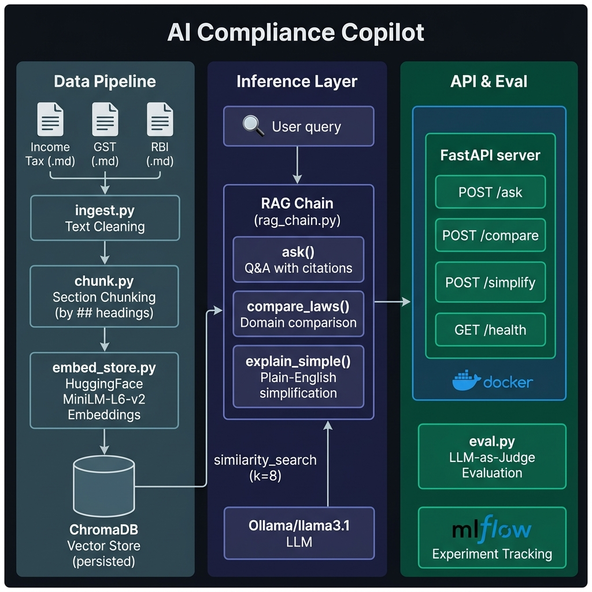

# 🏛️ AI Compliance Copilot

> A RAG system for querying Indian regulatory law — Income Tax Act 2025, GST (CGST Act), and RBI Directions — served as a Dockerised FastAPI microservice with MLflow-tracked evaluations.

[](https://python.org)
[](https://fastapi.tiangolo.com)
[](https://langchain.com)
[](https://trychroma.com)
[](https://mlflow.org)
[](https://docker.com)
[](https://ollama.com)

---

## 📋 Table of Contents

- [Overview](#-overview)
- [Architecture](#-architecture)
- [Features](#-features)
- [Eval Results](#-eval-results)
- [Setup Instructions](#-setup-instructions)
- [API Reference](#-api-reference)
- [Project Structure](#-project-structure)
- [Experiment Tracking](#-experiment-tracking)

---

## 🔍 Overview

**AI Compliance Copilot** is a Retrieval-Augmented Generation (RAG) assistant that lets you query complex Indian regulatory documents in plain English. Rather than reading hundreds of pages of law, ask a question and get a grounded answer with precise section citations — or compare two regulatory frameworks side by side.

**Key Design Principles:**
- **Grounded-answer prompt** — the LLM is instructed to answer only from retrieved context (instruction, not a guarantee: see `faithfulness_rate` in the eval)
- **Section-level citations** — every answer includes the source document and section heading
- **Three specialised chains** — Q&A, cross-domain comparison, and plain-English simplification
- **Local inference** — generation runs on a local Ollama instance; the embedding model is downloaded from Hugging Face on first run

---

## 🏗️ Architecture



```
┌──────────────────────────┐    ┌──────────────────────────┐    ┌─────────────────────────┐
│      DATA PIPELINE       │    │     INFERENCE LAYER       │    │      API & EVAL         │
│                          │    │                           │    │                         │
│  Income Tax / GST / RBI  │    │   User Query              │    │  FastAPI (port 8000)    │
│  Raw Markdown (.md)      │    │       │                   │    │  ┌─────────────────┐    │
│          │               │    │       ▼                   │    │  │  POST /ask      │    │
│     ingest.py            │    │  ┌────────────────────┐   │    │  │  POST /compare  │    │
│  (clean + structure)     │    │  │  rag_chain.py      │◄──┼────┤  │  POST /simplify │    │
│          │               │    │  │                    │   │    │  │  GET  /health   │    │
│     chunk.py             │    │  │  ask()             │   │    │  └─────────────────┘    │
│  (split by ## heading)   │    │  │  compare_laws()    │   │    │         │               │
│          │               │    │  │  explain_simple()  │   │    │    eval.py              │
│    embed_store.py        │    │  └─────────┬──────────┘   │    │  (LLM-as-Judge)         │
│  (MiniLM-L6-v2 embeds)   │    │            │              │    │         │               │
│          │               │    │     Ollama/llama3.1        │    │     MLflow              │
│      ChromaDB ───────────┼────┼─► similarity_search(k=8)  │    │  (experiment tracking)  │
│  (persisted vector store)│    │                           │    │                         │
└──────────────────────────┘    └──────────────────────────┘    └─────────────────────────┘
```

**Technology Stack:**

| Layer | Technology |
|---|---|
| LLM | Ollama · llama3.1 (local) |
| Embedding Model | `sentence-transformers/all-MiniLM-L6-v2` |
| Vector Store | ChromaDB (persisted on disk) |
| Orchestration | LangChain 0.2 · `RetrievalQA` chain |
| API Server | FastAPI + Uvicorn |
| Experiment Tracking | MLflow |
| Containerisation | Docker + Docker Compose |

---

## ✨ Features

### 1. 📖 `/ask` — Grounded Q&A with Citations

Ask any compliance question. The system retrieves the top-8 most relevant chunks from the vector store, filtered to a law domain if specified, and generates a grounded answer with full source citations.

**Request:**
```json
POST /ask
{
  "question": "What is the tax rate for capital gains on equity mutual funds?",
  "law_type": "income_tax"
}
```

**Actual Response:**
```json
{
  "answer": "The Income-tax Act, 2025 does not explicitly mention a specific tax rate for capital gains on equity mutual funds. However, it provides general provisions related to taxation of income and capital gains under various sections. To determine the applicable tax rate, one would need to refer to other relevant sections or notifications that may have been issued by the Central Government.\n\nIn general, the tax rates for capital gains in India are as follows:\n\n* Short-term capital gains (STCG) - 15% + surcharge and cess\n* Long-term capital gains (LTCG) - 10% + surcharge and cess\n\nHowever, these rates may be applicable only if the equity mutual funds are held for a period of more than one year. If the holding period is less than one year, the gains would be considered as short-term capital gains.\n\nIt's also worth noting that the tax rates mentioned above are subject to change based on the individual's income tax slab and other factors. Therefore, it's always best to consult with a tax professional or refer to the latest tax laws and notifications for accurate information.",
  "citations": [
    {
      "source": "income_tax_act.md",
      "section": "Section 8"
    },
    {
      "source": "income_tax_act.md",
      "section": "# INCOME-TAX ACT, 2025"
    },
    {
      "source": "income_tax_act.md",
      "section": "Section 7"
    },
    {
      "source": "income_tax_act.md",
      "section": "Section 4"
    },
    {
      "source": "income_tax_act.md",
      "section": "Section 2"
    },
    {
      "source": "income_tax_act.md",
      "section": "Section 12"
    },
    {
      "source": "income_tax_act.md",
      "section": "Section 1"
    },
    {
      "source": "income_tax_act.md",
      "section": "Section 3"
    }
  ]
}
```

---

### 2. ⚖️ `/compare` — Cross-Domain Law Comparison

Compare how two regulatory frameworks handle the same topic. The system independently retrieves context from each domain and produces a structured side-by-side analysis — using only document evidence, never outside knowledge.

**Request:**
```json
POST /compare
{
  "question": "How is the threshold limit for registration defined and enforced?",
  "law_type_a": "income_tax",
  "law_type_b": "gst"
}
```

**Actual Response:**
```json
{
  "comparison": "**Comparison: Threshold Limit for Registration**\n\n**Similarities:**\n\n* Both Income Tax and GST have provisions for determining residential status or registration eligibility based on physical presence in India (Income Tax: Section 6, GST: Not explicitly mentioned but implied through registration requirements).\n* In both domains, the threshold limit for registration is tied to the individual's or entity's income level (Income Tax: Section 6(7), GST: Not explicitly mentioned but implied through advance deposit of tax).\n\n**Differences:**\n\n* **Threshold Limit:** Income Tax has a more complex and nuanced approach to determining residential status, with multiple sub-sections and conditions (Section 6). In contrast, GST does not have an explicit threshold limit for registration, instead relying on the applicant's self-assessment and advance deposit of tax.\n* **Registration Process:** Income Tax requires individuals to meet specific residency requirements or income thresholds to be considered a resident (Section 6). GST, on the other hand, issues a Unique Identity Number (UIN) to applicants who are deemed eligible for registration, regardless of their physical presence in India (Chapter VI Registration).\n* **Advance Deposit of Tax:** GST requires casual taxable persons and non-resident taxable persons to make an advance deposit of tax equivalent to their estimated tax liability (Section 27). Income Tax does not have a similar provision.\n* **Registration Period:** GST has a specific registration period for casual taxable persons and non-resident taxable persons, which is valid for the period specified in the application or 90 days from the effective date of registration, whichever is earlier (Section 27). Income Tax does not have an explicit registration period."
}
```

---

### 3. 💬 `/simplify` — Plain-English Explanation

Gets a grounded technical answer first, then rewrites it in simple language suitable for a non-lawyer — preserving the original citations unchanged.

**Request:**
```json
POST /simplify
{
  "question": "What is the definition of aggregate turnover under the CGST Act?",
  "law_type": "gst"
}
```

**Actual Response:**
```json
{
  "answer": "Here's a rewritten version of the answer in plain English:\n\nWhen we talk about \"aggregate turnover\", it means the total value of all goods and services sold by a person from April 1st to the day they need to register under this law. But, if someone is giving loans or advances with interest or discount, that part won't be counted.\n\n(Note: I've kept the original answer's wording as much as possible while still making it simple and easy to understand.)",
  "citations": [
    {
      "source": "CGST-Act-Updated-31082021.md",
      "section": "CHAPTER VI REGISTRATION 48 financial year; or (ii) if some or all recipients of the credit do not have any turnover in their States or"
    },
    {
      "source": "CGST-Act-Updated-31082021.md",
      "section": "CHAPTER III LEVY AND COLLECTION OF TAX 29 [Explanation 1.––For the purposes of computing aggregate turnover of a person for determining his"
    },
    {
      "source": "CGST-Act-Updated-31082021.md",
      "section": "REMOVAL OF DIFFICULTY ORDERS 215"
    },
    {
      "source": "CGST-Act-Updated-31082021.md",
      "section": "138. Compounding of offences.—"
    },
    {
      "source": "CGST-Act-Updated-31082021.md",
      "section": "CHAPTER I PRELIMINARY 18 leviable to tax under this Act; (109) ―taxable territory‖means the territory to which the provisions of this Act apply;"
    },
    {
      "source": "CGST-Act-Updated-31082021.md",
      "section": "CHAPTER VI REGISTRATION 49 aggregate turnover in a financial year exceeds ten lakhrupees: [Provided further that the Government may, at"
    },
    {
      "source": "CGST-Act-Updated-31082021.md",
      "section": "4. Transfer of business assets"
    },
    {
      "source": "CGST-Act-Updated-31082021.md",
      "section": "1."
    }
  ]
}
```

---

## 📊 Eval Results

Evaluated with `python -m eval.run` on a frozen 74-item set (`eval/gold_v1.jsonl`: 57 single-section,
7 multi-section and 10 out-of-corpus questions across all three domains). Gold answers are verbatim
quotes from the source documents, so the set does not depend on chunk labels. Metrics: hit@1/3/5/8 and
MRR@10 (with and without a domain filter), LLM-judge correctness and faithfulness, refusal accuracy on
out-of-corpus questions, and p50/p95 latency. Every run is logged to MLflow (experiment `xray-target-eval`).

Current numbers and the before/after history are in [CHANGELOG.md](./CHANGELOG.md).

> The "85% retrieval accuracy" previously shown here was hit@8 on 20 self-written questions with the
> domain given as a filter and labels tuned to the output; the MLflow experiment grid shown here never
> completed a run. Both were removed.

---

## 🚀 Setup Instructions

### Prerequisites

| Requirement | Version |
|---|---|
| Python | ≥ 3.11 |
| Ollama | Latest |
| Docker (optional) | Latest |

### 1. Clone the Repository

```bash
git clone https://github.com/<your-username>/ai-compliance-copilot.git
cd ai-compliance-copilot
```

### 2. Install Ollama & Pull the Model

```bash
# Install Ollama from https://ollama.com
ollama pull llama3.1
# On Windows Ollama runs as a background app; no `ollama serve` needed.
```

### 3. Set Up Python Environment

```bash
python -m venv .venv

# Windows
.venv\Scripts\activate
# macOS/Linux
source .venv/bin/activate

pip install -r requirements.txt
```

### 4. Configure

All pipeline settings live in `config.yaml`. Any key can be overridden with an env var `RAG_<KEY>`
(e.g. `RAG_TOP_K=5`); `.env` is optional (see `.env.example`). No API keys are needed.

> If your system has `OLLAMA_HOST=0.0.0.0:11434` set (Ollama's server bind address), that is fine:
> the app uses `ollama_base_url` from the config, not `OLLAMA_HOST`.

### 5. Prepare Your Law Documents

Place your `.md` law documents into the appropriate domain folders:

```
data/raw/
├── income_tax/     ← Income Tax Act .md files
├── gst/            ← CGST Act, GST circulars .md files
└── rbi/            ← RBI Directions .md files
```

> **Tip:** Use [MarkItDown](https://github.com/microsoft/markitdown) or `pypdf` to convert PDF law documents to Markdown before placing them here.

### 6. Build the Vector Store

Run the data pipeline in sequence:

```bash
# Step 1: Clean and structure raw documents
python -m src.ingest

# Step 2: Chunk documents by legal section headings
python -m src.chunk

# Step 3: Embed and persist to ChromaDB
python -m src.embed_store
```

### 7. Start the API Server

**Option A — Local (development):**
```bash
uvicorn src.api:app --host 0.0.0.0 --port 8000 --reload
```

**Option B — Docker:**
```bash
# Build image
docker build -t compliance-copilot .

# Run container
docker run -p 8000:8000 --env-file .env compliance-copilot
```

**Option C — Docker Compose:**
```bash
docker-compose up --build
```

### 8. Verify the Server

```bash
curl http://localhost:8000/health
# → {"status": "ok", "version": "1.0.0"}
```

Open the interactive API docs at: **[http://localhost:8000/docs](http://localhost:8000/docs)**

---

## 📡 API Reference

| Method | Endpoint | Description |
|---|---|---|
| `POST` | `/ask` | RAG Q&A with citations |
| `POST` | `/compare` | Side-by-side cross-domain comparison |
| `POST` | `/simplify` | Plain-English answer (preserves citations) |
| `GET` | `/health` | Health check |

### Valid `law_type` values

| Value | Domain |
|---|---|
| `income_tax` | Income Tax Act, 2025 |
| `gst` | CGST Act / GST Circulars |
| `rbi` | RBI Directions & Frameworks |
| `null` / omit | Search across all domains |

### Run Evaluation

```bash
python -m eval.run --retrieval-only   # ~1 min, retrieval metrics only
python -m eval.run                     # + generation and LLM judge (needs Ollama: llama3.1, qwen3.5:4b)
```

---

## 📁 Project Structure

```
compliance-copilot/
│
├── src/
│   ├── api.py            # FastAPI app — /ask, /compare, /simplify, /health
│   ├── rag_chain.py      # retrieve(), ask(), compare_laws(), explain_simple()
│   ├── embed_store.py    # ChromaDB vector store build & load
│   ├── chunk.py          # ## headings, then token-capped to the embedder window
│   ├── ingest.py         # Raw .md ingestion & text cleaning pipeline
│   └── config.py         # Loads config.yaml + RAG_<KEY> env overrides
│
├── data/
│   ├── raw/
│   │   ├── income_tax/   # Raw Income Tax .md files
│   │   ├── gst/          # Raw GST .md files
│   │   └── rbi/          # Raw RBI .md files
│   └── processed/        # Cleaned JSON + chunks (auto-generated)
│
├── eval/
│   ├── gold_v1.jsonl     # Frozen 74-item eval set (verbatim-quote gold)
│   └── run.py            # python -m eval.run
│
├── chroma_db/            # Persisted ChromaDB vector store (auto-generated)
├── mlruns/               # MLflow experiment runs (auto-generated)
│
├── Dockerfile
├── docker-compose.yml
├── config.yaml           # All pipeline settings
├── requirements.txt      # Pinned direct deps (requirements.lock = full pins)
└── .env.example
```

---

## 🧪 Experiment Tracking

`eval.run` logs every run to MLflow at `./mlruns` (experiment `xray-target-eval`) with the full
config, data hashes and judge model digest as params. View with `mlflow ui --backend-store-uri ./mlruns`.

---

## 📝 License

No license file is included yet.
