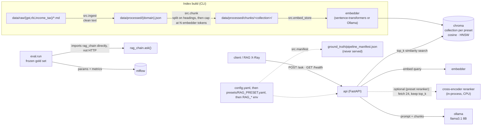

# AI Compliance Copilot

A local RAG assistant for Indian regulatory text: the **CGST Act + 5 GST circulars**, **6 RBI NBFC Master Directions**,
and **Chapters I–III of the Income-tax Act, 2025**. FastAPI + Chroma + Ollama, with a frozen eval set and MLflow tracking.

It is also built to be a **test target for RAG X-Ray**, a tool that infers a RAG pipeline from outside and confirms
its guesses with fault injection. So every pipeline setting is in one config, the services run separately, the API is
black-box by default, and the true pipeline is written to a ground-truth manifest the API never serves.

- Python 3.11 · LangChain 0.2 (Chroma wrapper only) · chromadb 0.5.3 · sentence-transformers 3.0.1 · Ollama · FastAPI · MLflow 2.16
- Runs fully locally once the models are downloaded; no API keys.

---

## Architecture



**Request path (`/ask`):** embed question, retrieve `top_k` chunks (optionally filtered by `law_type`), put them in the prompt in
rank order, one Ollama call (`temperature 0`, `num_ctx 8192`), return the answer plus the `(source, section)` of every chunk in the
prompt. If the model answers with the refusal sentence, citations are empty. With `reranker` set (preset `reranker`), vector search fetches `rerank_fetch_k` chunks and a cross-encoder keeps the
`top_k` best. No hybrid search, no query rewriting.

---

## Results

Frozen eval set `eval/gold_v2.jsonl` (v1 with 4 ambiguous quotes fixed; same numbers): 74 questions (57 single-section, 7 multi-section, 10 not in the corpus). Gold = verbatim quotes
from `data/raw`, so it works for any chunking. Judge = qwen3.5:4b (different model family from the generator), temperature 0.
Retrieval numbers are without a domain filter.

| | as shipped (v1) | Phase 2 fixes (`minilm` preset) | **`default` (bge-small, 512)** |
|---|---|---|---|
| hit@1 / hit@5 / hit@8 | 0.594 / 0.734 / 0.766 | 0.547 / 0.750 / 0.813 | 0.672 / 0.813 / 0.828 |
| MRR@10 | 0.653 | 0.651 | 0.732 |
| Answer correctness (judge, 1–5) | 2.75 | 3.22 | 3.34 |
| Faithful to retrieved context | 61% | 75% | 81% |
| Refuses out-of-corpus questions | 10/10 | 10/10 | 10/10 |
| Wrongly refuses in-corpus questions | 20% | 19% | 12.5% |
| `/ask` latency p50 / p95 | 3.3 s / 11.8 s | 2.1 s / 8.8 s | 3.8 s / 9.7 s |

Per-preset results, including the `reranker` preset (correctness 3.80, 59% correct, 9% false refusals, +2.1 s p50),
are in the CHANGELOG ("cross-encoder reranker, preset evals").

As-shipped numbers are on gold v1; the other two columns are on gold v2 (identical retrieval numbers on v1 and v2). Every
step changes several things at once; see the CHANGELOG for what changed between columns.

Caveats: 64 in-corpus questions, so one question = 1.6 points. All 74 gold items were drafted by an LLM and
re-checked against the source by the same LLM, then checked by hand by the owner (2026-11-18, no changes). The judge is a 4B model; use the numbers to compare runs, not as absolute truth.
Full history, including what was wrong with the old "85%" claim: [CHANGELOG.md](./CHANGELOG.md).

---

## Setup on Windows (local, no Docker)

Prerequisites: Python 3.11, [Ollama for Windows](https://ollama.com) (runs as a tray app; don't run `ollama serve`), Git.

```powershell
git clone https://github.com/Pranav-fscty/AI-Compliance-Copilot.git
cd AI-Compliance-Copilot
python -m venv .venv
.venv\Scripts\Activate.ps1
pip install -r requirements.lock        # exact pins (CPU torch from the PyTorch index); requirements.txt = direct deps
ollama pull llama3.1
```

Build the index for the active preset:

```powershell
python -m src.ingest        # data/raw -> data/processed (both committed; re-running reproduces them exactly)
python -m src.chunk         # -> data/processed/chunks/<collection>/
python -m src.embed_store   # -> chroma_db/, collection named in the preset
uvicorn src.api:app --port 8000
```

```powershell
curl.exe http://localhost:8000/health
curl.exe -X POST http://localhost:8000/ask -H "Content-Type: application/json" `
  -d '{\"question\": \"Who is a Non-Banking Financial Company?\"}'
```

> If `OLLAMA_HOST=0.0.0.0:11434` is set on your machine, that is Ollama's *server bind address*. The app uses
> `ollama_base_url` from the config instead, so you don't need to change it.

## Setup with Docker Compose

Four separate services, so each one can be stopped, slowed or broken on its own: `api`, `chroma` (server mode),
`ollama`, `mlflow`, all with healthchecks.

```powershell
docker compose up -d --build
docker compose run --rm api python -m src.chunk
docker compose run --rm api python -m src.embed_store     # index into the chroma service
docker compose ps                                         # wait for all four to be healthy
curl.exe http://localhost:8000/health
```

- The `ollama` container mounts your host models folder (`%USERPROFILE%\.ollama\models`), so models aren't downloaded again.
  Its image tag must match your host Ollama version (`OLLAMA_IMAGE_TAG`). Without that folder, run `docker compose exec ollama ollama pull llama3.1`.
- GPU: run `$env:COMPOSE_FILE = "docker-compose.yml;docker-compose.gpu.yml"` first, so **every** `docker compose`
  command (including `run` and `exec`) keeps the GPU. Passing `-f` only to `up` isn't enough: a later `docker compose run`
  without it recreates the ollama container without the GPU. Needs the NVIDIA driver with WSL2 support.
- Ports: api 8000, chroma 8001, mlflow 5000. Ollama isn't published, because the host Ollama already uses 11434.
- **Status:** run end to end on 2026-11-18 with the GPU override (all four healthy, `/ask` answers). The first request
  after a restart is slow (~170 s) while the model loads from the Windows models folder.

---

## Configuration and presets

Everything that defines the pipeline is in [`config.yaml`](./config.yaml): chunking strategy/size/overlap, embedder and its
prefixes, distance, `hnsw_search_ef`, `top_k`, reranker, prompt template, LLM, `num_ctx`, temperature, Chroma and Ollama endpoints.

Precedence: `config.yaml` < `presets/<RAG_PRESET>.yaml` < `RAG_<KEY>` environment variables. A misspelled preset, preset key
or `RAG_*` variable raises an error instead of being ignored.

| `RAG_PRESET` | Embedder (chunk tokens) | top_k | LLM | Eval status |
|---|---|---|---|---|
| `default` | bge-small-en-v1.5, HF (512) | 8 | llama3.1 8B | full |
| `minilm` | all-MiniLM-L6-v2, HF (256) | 8 | llama3.1 8B | full (the Phase 2 pipeline) |
| `reranker` | bge-small-en-v1.5, HF (512) + ms-marco-MiniLM-L-6 cross-encoder (fetch 24) | 8 | llama3.1 8B | full (best answers so far) |
| `nomic` | nomic-embed-text, Ollama (500) | 5 | llama3.1 8B | full |
| `small_llm` | bge-small-en-v1.5, HF (512) | 4 | qwen3.5:4b | full (judge = same model, likely flattered) |

Each preset uses its own Chroma collection, so all of them can be indexed side by side:

```powershell
$env:RAG_PRESET = "minilm"; python -m src.chunk; python -m src.embed_store; uvicorn src.api:app --port 8000
```

## Ground truth for RAG X-Ray

```powershell
python -m src.manifest      # -> ground_truth/pipeline_manifest.json for the active preset
```

The manifest is built from the config plus live facts: chunk counts and token lengths, collection size and HNSW settings,
embedding dimension, Ollama model digests, the full prompt template and its hash, the git commit and whether the tree is dirty.
The API never reads it. `ground_truth/` is gitignored and not in the Docker image.

## API

| Method | Path | Notes |
|---|---|---|
| `POST` | `/ask` | `{"question": str, "law_type": "gst" \| "rbi" \| "income_tax" \| null}` → `{"answer", "citations": [{"source", "section"}]}` |
| `GET` | `/health` | 200 `{"status":"ok","index":"ok","llm":"ok"}`, or 503 `degraded` if Chroma is empty or unreachable, or Ollama is down |
| `POST` | `/compare` | `{"question", "law_type_a", "law_type_b"}` → `{"comparison"}` |
| `POST` | `/simplify` | like `/ask`, then a plain-English rewrite |

- Black-box by default: no `/docs` or `/openapi.json`. `debug_endpoints: true` (or `RAG_DEBUG_ENDPOINTS=true`) adds them plus
  `POST /debug/retrieve`, which returns the raw retrieved chunks. Keep it off when testing with X-Ray.
- Every response has an `X-Request-ID` header. Send your own (`[A-Za-z0-9._-]{1,64}`) to correlate with the logs.
- Logs are JSON lines on stderr with `request_id`, plus one `request` line per call (method, path, status, duration_ms).
- No fault-injection hooks in the app: inject faults from outside (stop or slow a container, corrupt a collection, etc.).

---

## Evaluation

```powershell
python -m eval.run --retrieval-only                  # ~1 min: hit@1/3/5/8, MRR@10, multi-section coverage
python -m eval.run --run-name my_run                 # + generation and judge (needs llama3.1 and qwen3.5:4b in Ollama)
$env:RAG_PRESET = "minilm"; python -m eval.run --run-name minilm
python -m eval.bench embedders                       # rebuild + retrieval-eval each embedder candidate
python -m eval.bench llms                            # full eval per LLM (needs ~16 GB RAM free; resumable)
mlflow ui --backend-store-uri ./mlruns               # or MLFLOW_TRACKING_URI=http://localhost:5000 with compose
pytest -q tests eval/test_run.py
```

Full runs save a checkpoint after every step (`eval/checkpoints/`), so a crash or OOM kill can be resumed by running the same
command again. `--fresh` starts over. Every run logs the full resolved config, gold/chunk/index hashes and model digests.

---

## Project layout

```
config.yaml            all pipeline settings
presets/               default, minilm, nomic, small_llm overlays
src/
  ingest.py            data/raw -> data/processed/{domain}.json
  chunk.py             heading split + token cap with the embedder's tokenizer
  embed_store.py       embedder (hf | ollama) + Chroma (embedded or server)
  rag_chain.py         retrieve, build_prompt, ask, compare_laws, explain_simple
  api.py               FastAPI app, request ids, health checks
  logs.py              JSON log formatter
  manifest.py          ground_truth/pipeline_manifest.json
  config.py            config loading and precedence
eval/
  gold_v1.jsonl        original frozen eval set (Phases 1-3 numbers)
  gold_v2.jsonl        current eval set (4 quotes disambiguated; do not edit, make gold_v3)
  run.py               eval runner -> MLflow
  bench.py             Phase 3 embedder / LLM benchmark
  bench_embedders.json benchmark results
tests/                 config tests
docker-compose.yml     api, chroma, ollama, mlflow
docker-compose.gpu.yml GPU override for ollama
```

## Known limitations

- Income-tax coverage is only Chapters I–III of the Act; questions about later chapters are refused or answered badly.
- Section headings in citations are often noisy because of the PDF→Markdown conversion.
- `/compare` and `/simplify` prompts are in code, not in `config.yaml`, and have no eval.

No license file is included yet.
